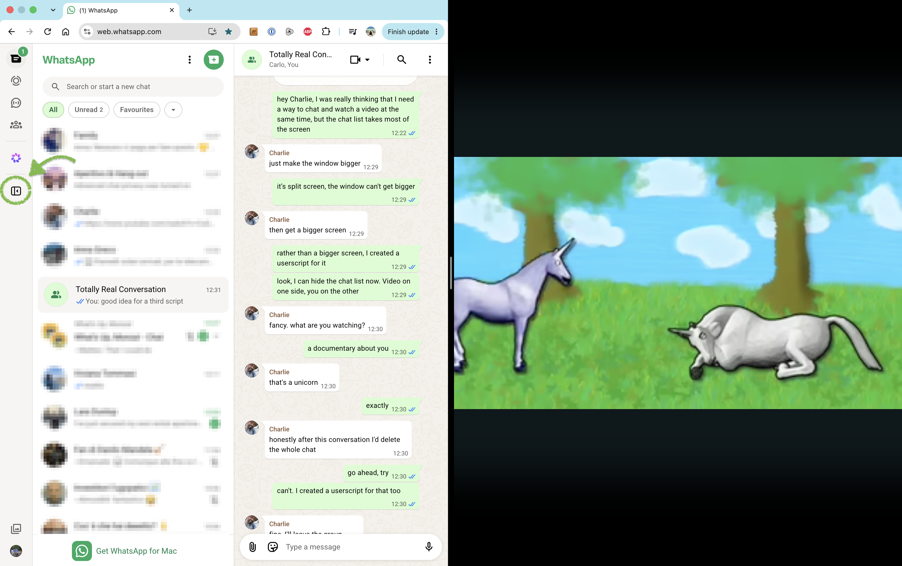
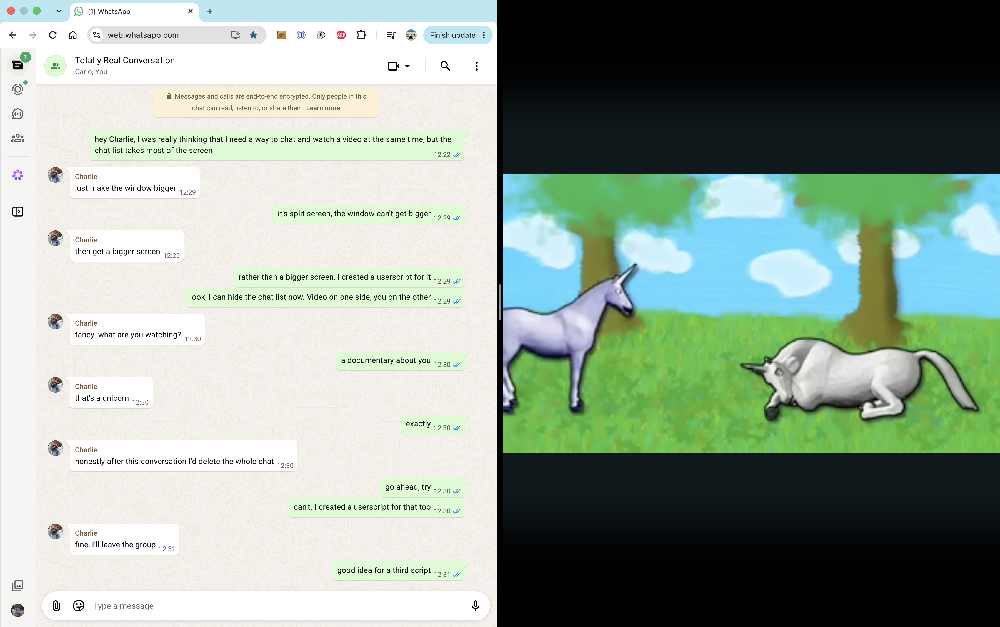
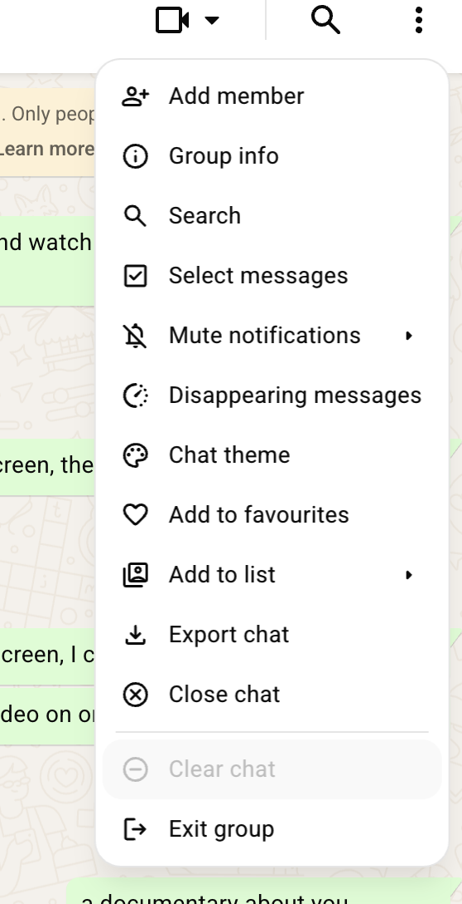
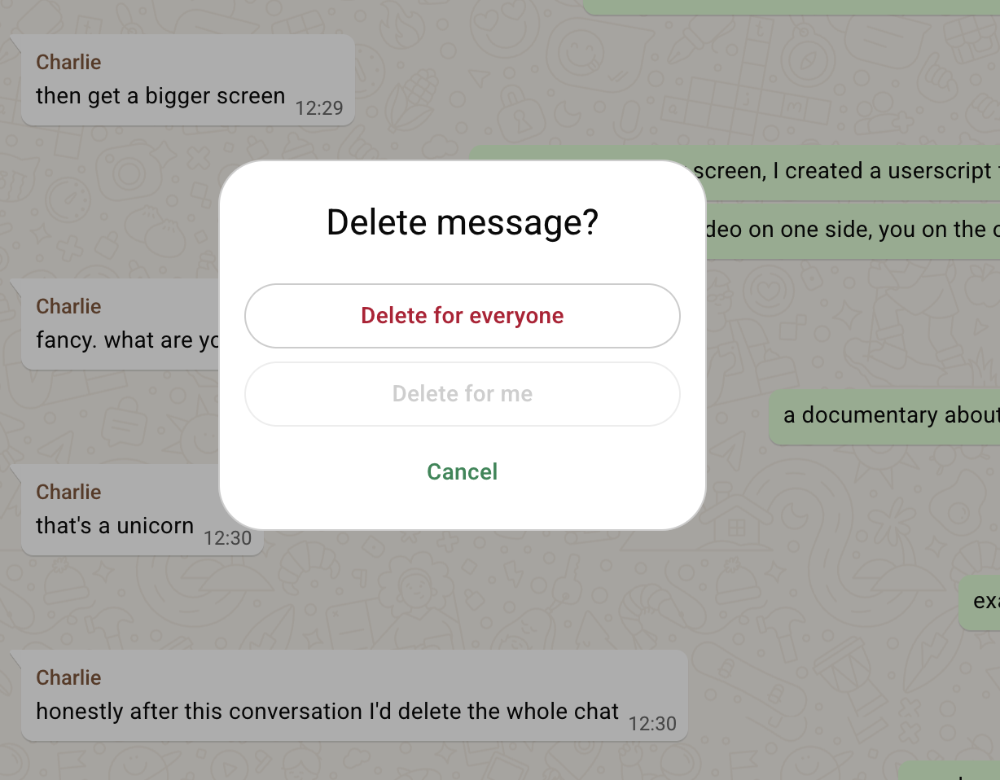

# WhatsApp Web userscripts

Two fixes for two everyday annoyances in [WhatsApp Web](https://web.whatsapp.com): a chat list that eats your screen, and a delete button that's one misclick away from wiping a conversation.

## 1. Get your screen back

You want to chat and watch a video side by side, but the chat list takes most of the window and the conversation gets squeezed into a strip.

[**Toggle chat list**](scripts/toggle-chat-list.user.js) adds a button to the left icon rail. One click and the chat list is gone: the conversation takes the full width, even in a narrow split-screen window. Click again to bring the list back. Also handy when sharing your screen, since nobody gets to read your chat list.

**Before:** the chat list hogs the window.

**After:** one click, and it's all conversation.

## 2. Never lose a chat to a misclick

How many times have you hit "Delete for me" when you meant "Delete for everyone"? Or cleared a whole chat by accident, with no way to get it back?

[**Block accidental deletion**](scripts/block-chat-deletion.user.js) takes those options off the table. "Delete chat", "Clear chat" and "Delete for me" are greyed out, and clicking them only shows a notice. The delete-chat keyboard shortcut is blocked too. "Delete for everyone" still works, so you can still unsend a message.

  
  

Need to really delete something? Either do it from your phone, or temporarily disable the script in your userscript manager.

## Install

1. Install a userscript manager browser extension, such as [Tampermonkey](https://www.tampermonkey.net/).
2. Open a script's raw file (links above, then **Raw**). The extension offers to install it.
3. Reload WhatsApp Web.

Installed this way, the extension picks up updates automatically.

Tested with Tampermonkey. The scripts use no manager-specific APIs, so any userscript manager should work: [Violentmonkey](https://violentmonkey.github.io/), [Greasemonkey](https://www.greasespot.net/), [ScriptCat](https://scriptcat.org/), or [Userscripts](https://github.com/quoid/userscripts) for Safari. If one doesn't, open an issue.

## Other languages

The deletion blocker matches menu labels by text, so it currently works only with WhatsApp in English or Italian. In any other language it does nothing. To add yours, open a PR that adds the translated labels to the `LABELS` list at the top of the script.

## Caveats

WhatsApp Web changes its page structure often, and that can break the scripts without warning. If one stops working, open an issue. Fixes land when I have time.

## Disclaimer

Not affiliated with, endorsed by, or sponsored by WhatsApp or Meta. These scripts only change how the page looks and behaves in your own browser. They don't automate messaging or touch your account data.

## License

[MIT](LICENSE)
